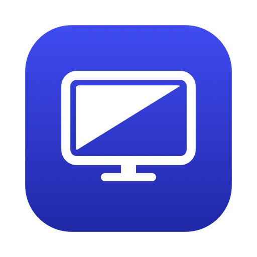
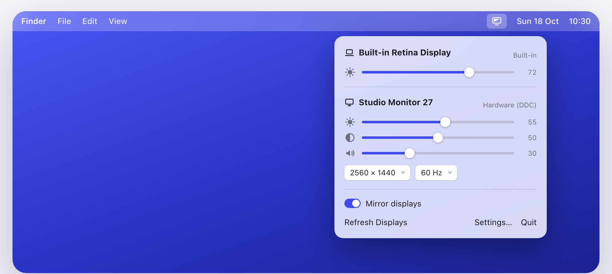
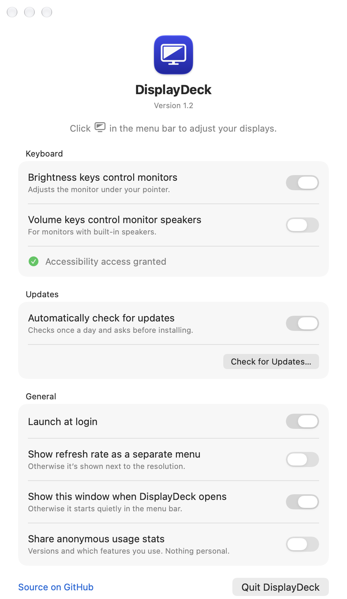

<div align="center">



# DisplayDeck

**Your monitors, from the menu bar.**

Brightness, contrast and volume for external displays, plus brightness keys that actually work on them.
<br>A tiny, free and open-source macOS app.

[](https://github.com/rahgurung/DisplayDeck/actions/workflows/ci.yml)
[](https://github.com/rahgurung/DisplayDeck/releases/latest)
[](https://github.com/rahgurung/DisplayDeck/releases)
[](#requirements)
[](#requirements)
[](Sources)
[](LICENSE)

[**Download**](https://github.com/rahgurung/DisplayDeck/releases/latest) · [**Website**](https://displaydeck.rahulgurung.com) · [Install](#-install) · [Features](#-features) · [Build from source](#%EF%B8%8F-build-from-source)

<br>



</div>

<br>

## ✨ Features

| | |
|---|---|
| ☀️ **Real brightness** | Changes the monitor's own backlight over DDC/CI rather than drawing a dark overlay, so blacks stay black. |
| ⌨️ **Brightness keys that work** | Your Mac's brightness keys control the display under your pointer, or every display at once (*Settings → Keyboard*; hold ⌃ Control to switch for one press), with a clean on-screen indicator. |
| ⌘ **Custom shortcuts** | Your own shortcuts for brightness, contrast, volume, mute and switching a monitor's input, on any keyboard (*Settings → Shortcuts*). No Accessibility access needed. |
| 🔌 **Input switching** | Switch a monitor between HDMI, DisplayPort and USB-C from its card, using the inputs the monitor reports. Rename any input, e.g. "Work laptop". |
| 🔆 **Follow the built-in display** | Optional: monitors follow your MacBook's brightness, auto-brightness included. Set a monitor brighter or dimmer once and it keeps that balance across the whole range. Off by default; turn it on in *Settings → Displays*. |
| 🔊 **Monitor speakers** | Volume for speakers built into your monitor, from a slider or your volume keys. |
| ◐ **Contrast** | Adjust contrast on monitors that support it. |
| 🖥️ **Resolution & refresh rate** | Switch per display in two clicks, no System Settings detour. |
| 🎚️ **Presets** | Save every display's brightness, contrast and volume as a preset like "Day" or "Night", then apply it from the menu or a shortcut (*Settings → Presets*). |
| 🪞 **Mirroring** | Toggle display mirroring straight from the menu. |
| ⏻ **Turn a display off** | Optional: a button on each display's card puts the monitor in standby, or turns its picture black if it can't sleep. Click again to turn it back on. Off by default; turn it on in *Settings → Displays*. |
| 🌗 **Software dimming** | Displays that can't be controlled over DDC still dim, in software. Optionally, monitors can go darker than their own minimum for late nights: drag brightness below 0 (*Settings → Displays*). |
| 🚀 **Launch at login** | Starts quietly in the menu bar when you log in. |
| 🔄 **Automatic updates** | Checks for new versions daily and installs them with one click, via [Sparkle](https://sparkle-project.org). |

## 📦 Install

### Homebrew

```sh
brew install --cask rahgurung/tap/displaydeck
```

### Download

1. Grab the latest **`DisplayDeck-x.y.dmg`** from [Releases](https://github.com/rahgurung/DisplayDeck/releases/latest).
2. Open it and drag **DisplayDeck** into **Applications**.
3. Launch it. The  icon appears in your menu bar.

Releases are signed with a Developer ID and notarized by Apple, so they open without Gatekeeper warnings.

### Requirements

- 🍎 Apple Silicon Mac (M1 or later)
- 💻 macOS 14 Sonoma or later

## 🕹️ Usage

- **Click** the menu bar icon to see every connected display with its own sliders and pickers.
- **Open DisplayDeck again** (Finder, Spotlight, Launchpad) or press <kbd>⌘</kbd> <kbd>,</kbd> in the menu to bring up **Settings**.
- **Brightness / volume keys** need **Accessibility** access: macOS asks the first time, or use *Open Settings…* in DisplayDeck's settings window. You can switch either key off.

<div align="center">
<picture>
  <source media="(prefers-color-scheme: dark)" srcset="docs/settings-dark.png">
  
</picture>
</div>

## 🔌 Compatibility

DisplayDeck talks to monitors over **DDC/CI**, the control channel most displays expose over the video cable.

| Connection | Hardware control |
|---|---|
| USB‑C / Thunderbolt | ✅ Almost always |
| DisplayPort | ✅ Almost always |
| HDMI | ⚠️ Depends on the port and monitor; the built-in HDMI on some Macs doesn't pass DDC |
| Docks, adapters, TVs | ⚠️ Often blocked |
| Apple displays & built-in screen | ✅ Native Apple brightness |

When a display can't be controlled directly, its menu label reads **Software dimming** and DisplayDeck dims it in software instead.

## 🔒 Privacy

Release builds send a few **anonymous** usage signals to [TelemetryDeck](https://telemetrydeck.com) so I can see how many people use DisplayDeck and whether hardware control works on their monitors:

- App and macOS version, region
- How many displays are connected and how each is controlled (DDC / software / Apple)
- Which options are on, and when the menu or settings window is opened, a monitor's input is switched, a preset is applied or a display is turned off

Release builds also check `https://displaydeck.rahulgurung.com/appcast.xml` once a day for new versions (turn it off in **Settings → General**). That request sends nothing but a normal web request; Sparkle's optional system profile is off.

Each install is identified only by a hashed random ID. Nothing about you, your files or your screen is collected. Turn it off in **Settings → Share anonymous usage stats**. Builds from source send nothing.

## 🛠️ Build from source

No Xcode project. You only need the Command Line Tools (`xcode-select --install`).

```sh
git clone https://github.com/rahgurung/DisplayDeck.git
cd DisplayDeck
./build.sh            # builds build/DisplayDeck-Dev.app
./build.sh --install  # also copies it to /Applications and launches it
```

Source builds are **DisplayDeck Dev**, a separate app from the release with its own settings and permissions, so you can
keep the release installed. While DisplayDeck Dev runs, it quits the release (two copies would both talk to your
monitors) and opens it again when it quits.

Every push to `main` and every pull request is built by [CI](.github/workflows/ci.yml) on GitHub's macOS runner; the built app is attached to each run for 7 days.

Local builds are signed with your Apple Development certificate if you have one, so macOS keeps the Accessibility permission across rebuilds. Otherwise they're ad-hoc signed.

<details>
<summary><b>Project layout</b></summary>

```
Sources/
  App.swift             Menu bar extra, menu UI and app lifecycle
  DisplayManager.swift  Display discovery, modes and mirroring
  DisplayControl.swift  Apple brightness and software (gamma) dimming
  DDC.swift             DDC/CI over IOAVService (Apple Silicon)
  MediaKeys.swift       Brightness / volume key interception
  Shortcuts.swift       Custom global shortcuts (Carbon hot keys)
  HUD.swift             On-screen level indicator
  SettingsWindow.swift  Settings window
  MenuBarIcon.swift     Menu bar template glyph
  Telemetry.swift       Anonymous usage signals (TelemetryDeck)
  Updater.swift         In-app updates (Sparkle)
Resources/
  make-icon.swift       Draws the app icon: swift Resources/make-icon.swift
docs/                   Website (displaydeck.rahulgurung.com)
build.sh                Build, install and release build (sign, notarize, DMG)
release.sh              Cut or update a release branch, which triggers the Release workflow
Packaging/              Cask template, site/appcast data, release versioning and secrets helpers
```

</details>

<details>
<summary><b>Releasing</b></summary>

Releases are cut from **release branches** and built on GitHub.

| Do this | What gets released |
|---|---|
| Push a new `release/1.1` branch, or run `./release.sh 1.1` on `main` | **1.1** |
| Push more commits to `release/1.1`, or commit there and run `./release.sh` | **1.1.1**, then **1.1.2**, … |
| Push `release/1.2.3` | exactly **1.2.3**, once |

Before cutting a release, add a `## <version>` section to [CHANGELOG.md](CHANGELOG.md); it becomes the GitHub release notes (patch releases without a section get the list of commits instead).

Every push to a `release/*` branch runs the [Release workflow](.github/workflows/release.yml) on a macOS runner. It signs the app with the Developer ID certificate, notarizes and staples the DMG, and publishes the GitHub release. It then redeploys the website from the release branch, so the download buttons switch to the new version and the previous one moves to *Older versions*, and updates the cask in [rahgurung/homebrew-tap](https://github.com/rahgurung/homebrew-tap). Fixes made on a release branch should be merged back into `main`. The workflow can also be started by hand from **Actions → Release → Run workflow**.

The website (`docs/`) also changes only with releases; pushing to `main` never deploys it. To publish a website-only fix between releases, run **Actions → Deploy website to GitHub Pages → Run workflow** on `main`.

One-time setup: export the Developer ID Application certificate as a `.p12`, create an App Store Connect API key, then run `Packaging/set-release-secrets.sh <cert.p12> <AuthKey.p8> <key-id> <issuer-id>`. Updates are signed with an EdDSA key (`SPARKLE_PRIVATE_KEY` secret; the original is in the maintainer's login keychain under the "DisplayDeck" account, and the public key is in `build.sh`). Each release uploads `appcast.json` with the DMG's signature, and the site deploy turns those into `appcast.xml`. Build numbers come from the number of `v*` tags, so never delete a release tag. The TelemetryDeck App ID is the `TELEMETRYDECK_APP_ID` repository variable.

To build a release locally instead: `VERSION=1.1 ./build.sh --release` (needs the certificate in your keychain and a `DisplayDeck` notarytool profile).

</details>

## ❓ Why isn't it on the Mac App Store?

DDC control needs private macOS APIs, and the brightness keys need a system-wide event tap. Neither is allowed in the App Store sandbox, which is why DisplayDeck, like MonitorControl and BetterDisplay, is distributed directly.

## 🤝 Contributing

Issues and pull requests are welcome. If your monitor doesn't respond to DDC, please [open an issue](https://github.com/rahgurung/DisplayDeck/issues/new) with the monitor model, the connection type and your Mac model.

## 📄 License

[MIT](LICENSE) © 2026 Rahul Gurung
